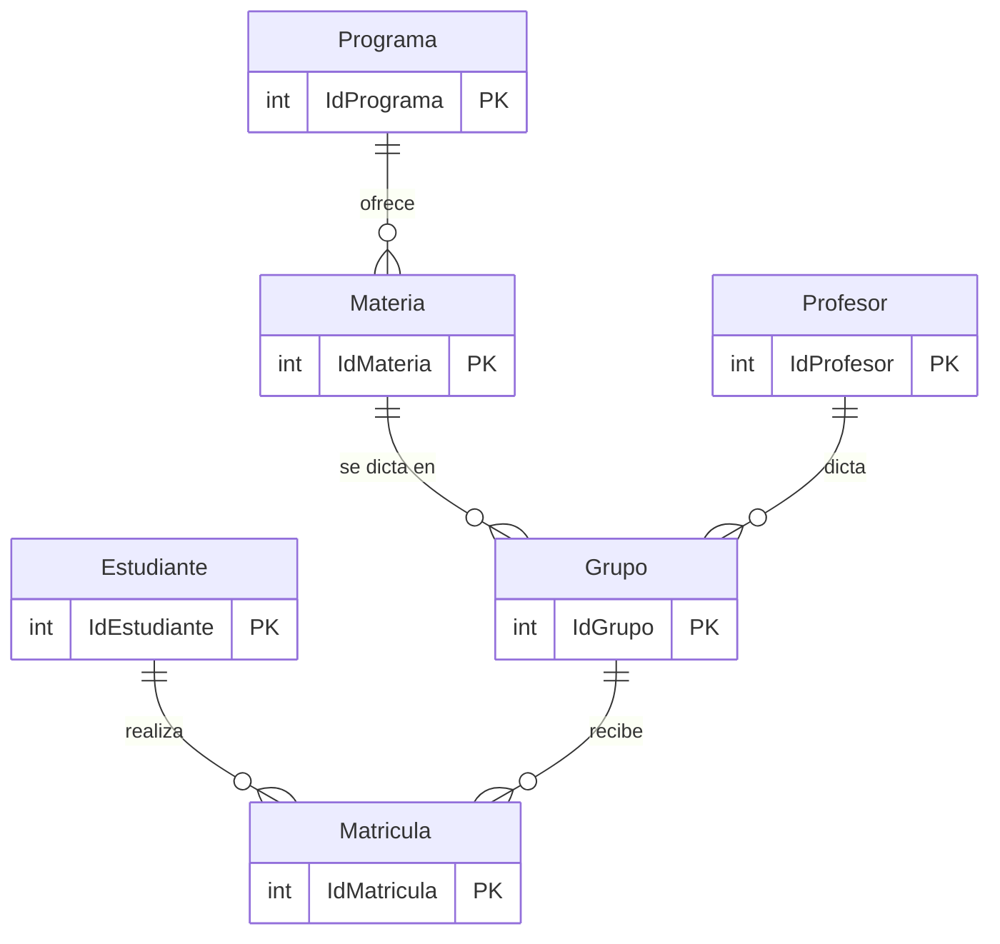

<div align="center">

# Práctica 4: Seguridad en Bases de Datos
### Usuarios · Privilegios · Roles · Inyección SQL · Auditoría

**Universidad Manuela Beltrán (UMB)** · Ingeniería de Software
Teoría de Bases de Datos · Guía de Laboratorio N.º 4 · II semestre 2026


</div>

---

## Equipo

| Integrante | Rol en el equipo |
|---|---|
| Joan Sebastian Romaña Tavera | Integrante |
| Juan Manuel Gamez Nieto | Integrante |
| Esteban Salvador Guzmán | Integrante |

**Docente:** John Leonardo Hernández Matiz

---

## Índice

1. [Resumen](#1-resumen)
2. [Objetivos](#2-objetivos)
3. [Entorno y herramientas](#3-entorno-y-herramientas)
4. [Estructura del repositorio](#4-estructura-del-repositorio)
5. [Cómo ejecutar la práctica](#5-cómo-ejecutar-la-práctica)
6. [Sistema base: `Guia_3`](#6-sistema-base-guia_3)
7. [Tarea previa: GRANT vs. REVOKE](#7-tarea-previa-grant-vs-revoke)
8. [Actividad 1: Usuarios y privilegios directos](#8-actividad-1-usuarios-y-privilegios-directos)
9. [Actividad 2: Roles corporativos](#9-actividad-2-roles-corporativos)
10. [Actividad 3: Prevención de inyección SQL](#10-actividad-3-prevención-de-inyección-sql)
11. [Actividad 4: Trigger de auditoría](#11-actividad-4-trigger-de-auditoría)
12. [Actividad 5: Informe de seguridad](#12-actividad-5-informe-de-seguridad)
13. [Preguntas orientadoras](#13-preguntas-orientadoras)
14. [Conclusiones](#14-conclusiones)
15. [Referencias](#15-referencias)

---

## 1. Resumen

En esta práctica el equipo asume el rol de **administrador de bases de datos (DBA)** sobre el sistema académico construido en las Prácticas 1 a 3 (`Guia_3`). Sobre ese sistema se implementan cinco capas de seguridad:

| # | Capa | Pregunta que responde | Control implementado | Actividad |
|:-:|---|---|---|:-:|
| 1 | Autenticación | ¿Quién eres y desde dónde te conectas? | Cuentas `usuario@localhost` con contraseña propia | 1 |
| 2 | Autorización discrecional (DAC) | ¿Qué puedes hacer y sobre qué objeto? | `GRANT` / `REVOKE` por tabla y por operación | 1 |
| 3 | Autorización basada en roles (RBAC) | ¿Qué permisos corresponden a tu cargo? | `rol_admin`, `rol_consultor`, `rol_operador` | 2 |
| 4 | Aplicación | ¿Puede un formulario inyectar SQL? | Consultas parametrizadas con MySQL Connector | 3 |
| 5 | Auditoría | ¿Quién cambió qué, cuándo y qué había antes? | Triggers `AFTER UPDATE` / `AFTER DELETE` → `auditoria_log` | 4 |

El principio que guía todas las decisiones es el de **mínimo privilegio**: cada cuenta recibe solo lo que su función necesita (Elmasri y Navathe, 2016).

---

## 2. Objetivos

**General:** implementar mecanismos de seguridad en una base de datos MySQL mediante gestión de usuarios, asignación de privilegios, roles y auditoría.

**Específicos:**

- Crear cuatro cuentas con distintos niveles de acceso y verificar qué puede y qué no puede hacer cada una.
- Agrupar privilegios en roles corporativos y demostrar la diferencia entre privilegio **directo** y **heredado**.
- Identificar consultas vulnerables a inyección SQL y reescribirlas con *prepared statements*.
- Registrar automáticamente los cambios sobre datos sensibles mediante triggers de auditoría.
- Elaborar un mapa de seguridad del sistema con hallazgos y recomendaciones para producción.

---

## 3. Entorno y herramientas

| Recurso | Uso en la práctica |
|---|---|
| **MySQL 8.x** (local, `127.0.0.1:3306`) | Motor de base de datos |
| **Visual Studio Code** + extensión Database Client | Ejecución de scripts de las Actividades 1, 2 y tarea previa |
| **MySQL Workbench** | Ejecución y verificación de la Actividad 4 |
| **Python 3.x** + `mysql-connector-python` | Scripts de la Actividad 3 |
| **draw.io** | Diagrama de roles y usuarios |

---

## 4. Estructura del repositorio

```
Guia_4/
├── README.md                                   ← este documento
├── Diagrama_Actividad_previa_VF.drawio.pdf     ← diagrama de roles y usuarios
├── Guía IV_prebuild_Alpha.docx                 ← informe de laboratorio
│
├── Scripts/                                    ← preparación del sistema base
│   ├── 01_Tablas.sql                           crea Guia_3 y sus 6 tablas
│   └── 02_Datos.sql                            pobla las tablas
│
├── Actividad-tarea-previa/
│   ├── Script/00_TareaPrevia_GRANT_vs_REVOKE.sql
│   └── Imagenes/                               22 capturas
│
├── Actividad-1/
│   ├── Script/01_Actividad1_Usuarios_Privilegios.sql
│   └── Imagenes/                               28 capturas
│
├── Actividad-2/
│   ├── Scripts/02_Actividad2_Roles_Corporativos.sql
│   └── Imagenes/                               49 capturas
│
├── Actividad 3/
│   └── Scripts/
│       ├── vulnerable-ej.py                    código ANTES (vulnerable)
│       ├── Segura.py                           código DESPUÉS (parametrizado)
│       └── explicacion.txt
│
├── Actividad 4/
│   ├── Scripts/
│   │   ├── triggers.sql                        tabla de log + 2 triggers
│   │   └── testeo logs.sql                     simulación de cambios
│   └── Capturaa/                               evidencias del log
│
└── Actividad 5/
    ├── Informe_Seguridad.md                    informe completo de seguridad
    ├── Practica4_Informe_Seguridad_Guia3_1.pdf
    └── Scripts/05_Actividad5_Mapa_Seguridad.sql
```

---

## 5. Cómo ejecutar la práctica

> Todos los scripts se ejecutan como `root` (o una cuenta con `CREATE USER` y `GRANT OPTION`) sobre un MySQL 8.x local.

**Orden obligatorio:** cada script depende de lo que dejó el anterior.

```mermaid
flowchart LR
    A[01_Tablas.sql] --> B[02_Datos.sql]
    B --> C[01_Actividad1_Usuarios_Privilegios.sql]
    C --> D[02_Actividad2_Roles_Corporativos.sql]
    D --> E[00_TareaPrevia_GRANT_vs_REVOKE.sql]
    E --> F[triggers.sql]
    F --> G[testeo logs.sql]
    G --> H[05_Actividad5_Mapa_Seguridad.sql]
```



| Paso | Script | Qué deja listo |
|:-:|---|---|
| 1 | `Scripts/01_Tablas.sql` | Base `Guia_3` con 6 tablas y sus llaves foráneas |
| 2 | `Scripts/02_Datos.sql` | Datos de prueba (5 programas, 5 estudiantes, 5 profesores, 5 materias, 5 grupos, 13 matrículas) |
| 3 | `Actividad-1/Script/01_...sql` | Tabla `auditoria_log` y 4 usuarios con privilegios directos |
| 4 | `Actividad-2/Scripts/02_...sql` | 3 roles; privilegios directos reemplazados por roles (excepto `auditor`) |
| 5 | `Actividad-tarea-previa/Script/00_...sql` | 5 ejemplos de GRANT/REVOKE; vuelve al estado de la Actividad 2 |
| 6 | `Actividad 4/Scripts/triggers.sql` | Triggers de auditoría sobre `Estudiante` |
| 7 | `Actividad 4/Scripts/testeo logs.sql` | Eventos `UPDATE` y `DELETE` registrados en el log |
| 8 | `Actividad 5/Scripts/05_...sql` | Consultas de solo lectura para el mapa de seguridad |

**Actividad 3 (Python):**

```bash
pip install mysql-connector-python
python "Actividad 3/Scripts/vulnerable-ej.py"   # muestra el ataque
python "Actividad 3/Scripts/Segura.py"          # muestra la defensa
```

Ambos scripts piden usuario y contraseña por consola (`getpass`); la contraseña no queda escrita en el código.

---

## 6. Sistema base: `Guia_3`

Sistema académico de las Prácticas 1 a 3, con seis tablas relacionadas más la tabla de auditoría creada en esta práctica.



| Tabla | Llave primaria | Relación |
|---|---|---|
| `Programa` | `IdPrograma` | — |
| `Estudiante` | `IdEstudiante` | — |
| `Profesor` | `IdProfesor` | — |
| `Materia` | `IdMateria` | → `Programa` |
| `Grupo` | `IdGrupo` | → `Materia`, `Profesor` |
| `Matricula` | `IdMatricula` | → `Estudiante`, `Grupo` |
| `auditoria_log` | `id` | Nueva en esta práctica (Actividad 1; la llena la Actividad 4) |

---

## 7. Tarea previa: GRANT vs. REVOKE

📄 Script: [`00_TareaPrevia_GRANT_vs_REVOKE.sql`](Actividad-tarea-previa/Script/00_TareaPrevia_GRANT_vs_REVOKE.sql) · 🖼️ Evidencias: [`Actividad-tarea-previa/Imagenes/`](Actividad-tarea-previa/Imagenes/)

| | `GRANT` | `REVOKE` |
|---|---|---|
| **Qué hace** | Otorga un privilegio o un rol | Retira un privilegio o un rol ya otorgado |
| **Efecto** | Suma capacidades | Resta capacidades |
| **Requisito** | Quien lo ejecuta necesita `GRANT OPTION` sobre ese privilegio | Igual |
| **Cuándo aplica** | De inmediato, sin reconectar | De inmediato, sin reconectar |
| **Analogía** | Entregar una llave | Quitar una llave entregada |

### Los cinco ejemplos

Cada ejemplo **otorga**, **revoca** y **restaura** el privilegio para evidenciar el efecto de ambos comandos.

| # | Ejemplo | Sentencias | Lo que demuestra |
|:-:|---|---|---|
| 1 | Privilegio puntual sobre una tabla | `GRANT/REVOKE SELECT ON Guia_3.Estudiante … 'analista'` | El caso más granular |
| 2 | Privilegio de escritura | `GRANT/REVOKE INSERT ON Guia_3.Matricula … 'operador'` | `REVOKE` solo quita lo que se nombra |
| 3 | Esquema completo + `GRANT OPTION` | `GRANT ALL … WITH GRANT OPTION` / `REVOKE ALL PRIVILEGES, GRANT OPTION` | La capacidad de delegar es un privilegio aparte y debe revocarse explícitamente |
| 4 | Privilegio sobre un rol | `GRANT/REVOKE UPDATE ON Guia_3.Grupo … 'rol_operador'` | Afecta a **todos** los usuarios del rol a la vez |
| 5 | Rol completo a un usuario | `GRANT/REVOKE 'rol_consultor' … 'analista'` + `SET DEFAULT ROLE` | El usuario gana o pierde todo lo heredado de un solo golpe |

```sql
-- Ejemplo 3: la delegación debe revocarse de forma explícita
GRANT  ALL PRIVILEGES ON Guia_3.* TO 'admin_bd'@'localhost' WITH GRANT OPTION;
REVOKE ALL PRIVILEGES, GRANT OPTION FROM 'admin_bd'@'localhost';
```

Al final, el script **retira los privilegios directos** que dejaron los ejemplos 1 a 3 y verifica con `SHOW GRANTS … USING` que el sistema quedó igual que al cierre de la Actividad 2.

---

## 8. Actividad 1: Usuarios y privilegios directos

📄 Script: [`01_Actividad1_Usuarios_Privilegios.sql`](Actividad-1/Script/01_Actividad1_Usuarios_Privilegios.sql) · 🖼️ Evidencias: [`Actividad-1/Imagenes/`](Actividad-1/Imagenes/)

### 8.1 Qué hace el script

1. Crea la tabla `auditoria_log` (id, tabla, operacion, usuario, fecha, dato_anterior).
2. Crea las cuentas `admin_bd`, `analista`, `operador` y `auditor`, todas restringidas a `localhost`.
3. Asigna privilegios **directos** a cada cuenta.
4. Verifica con `SHOW GRANTS` y documenta las pruebas de acceso por usuario.

> **Decisión de diseño:** `analista` y `operador` reciben privilegios **tabla por tabla** y nunca con `Guia_3.*`. Un comodín de esquema incluiría `auditoria_log` sin que nadie lo notara; solo `auditor` debe poder leerla.

### 8.2 Privilegios otorgados

| Usuario | Privilegios | Alcance |
|---|---|---|
| `admin_bd` | `ALL PRIVILEGES` + `GRANT OPTION` | `Guia_3.*` (incluye `auditoria_log`) |
| `analista` | `SELECT` | Las 6 tablas de negocio |
| `operador` | `SELECT`, `INSERT`, `UPDATE` | Las 6 tablas de negocio |
| `auditor` | `SELECT` | Solo `auditoria_log` |

### 8.3 Matriz de permisos

| Usuario | SELECT | INSERT | UPDATE | DELETE | Leer `auditoria_log` | GRANT OPTION |
|---|:-:|:-:|:-:|:-:|:-:|:-:|
| `admin_bd` | ✔ | ✔ | ✔ | ✔ | ✔ | ✔ |
| `analista` | ✔ | ✘ | ✘ | ✘ | ✘ | ✘ |
| `operador` | ✔ | ✔ | ✔ | ✘ | ✘ | ✘ |
| `auditor` | ✘ | ✘ | ✘ | ✘ | ✔ | ✘ |

### 8.4 Pruebas de acceso por usuario

| Usuario | Sentencia | Resultado esperado |
|---|---|:-:|
| `admin_bd` | `INSERT` / `DELETE` en `Programa`, `GRANT` a otro usuario | ✔ OK |
| `analista` | `SELECT * FROM Estudiante;` | ✔ OK |
| `analista` | `INSERT INTO Programa …` / `SELECT * FROM auditoria_log;` | ✘ `ERROR 1142` |
| `operador` | `INSERT` + `UPDATE` en `Matricula` | ✔ OK |
| `operador` | `DELETE FROM Matricula …` | ✘ `ERROR 1142` |
| `auditor` | `SELECT * FROM auditoria_log;` | ✔ OK |
| `auditor` | `SELECT * FROM Estudiante;` / `INSERT` en el log | ✘ `ERROR 1142` |

`ERROR 1142` es el código con el que MySQL rechaza una sentencia para la que la cuenta no tiene privilegio (*command denied to user*).

---

## 9. Actividad 2: Roles corporativos

📄 Script: [`02_Actividad2_Roles_Corporativos.sql`](Actividad-2/Scripts/02_Actividad2_Roles_Corporativos.sql) · 🖼️ Evidencias: [`Actividad-2/Imagenes/`](Actividad-2/Imagenes/) · 📐 Diagrama: [`Diagrama_Actividad_previa_VF.drawio.pdf`](Diagrama_Actividad_previa_VF.drawio.pdf)

### 9.1 Qué hace el script

1. Crea los roles `rol_admin`, `rol_consultor` y `rol_operador`.
2. Asigna a cada rol los mismos privilegios que tenía la cuenta equivalente en la Actividad 1.
3. **Retira los privilegios directos** de `admin_bd`, `analista` y `operador`. `auditor` conserva el suyo a propósito, como punto de contraste.
4. Asigna cada rol a su usuario y lo activa con `SET DEFAULT ROLE`.
5. Verifica con `SHOW GRANTS`, con y sin `USING`.
6. Demuestra que un `REVOKE` sobre un rol afecta a todos sus miembros.

### 9.2 Roles y usuarios

```mermaid
flowchart LR
    admin[admin_bd@localhost] -->|hereda| RA[rol_admin]
    analista[analista@localhost] -->|hereda| RC[rol_consultor]
    operador[operador@localhost] -->|hereda| RO[rol_operador]
    auditor[auditor@localhost] -.->|directo| LOG[(auditoria_log)]

    RA -->|ALL + GRANT OPTION| G3[(Guia_3.*)]
    RC -->|SELECT| T6[(6 tablas de negocio)]
    RO -->|SELECT, INSERT, UPDATE| T6
```

| Rol | Privilegios | Asignado a |
|---|---|---|
| `rol_admin` | `ALL PRIVILEGES ON Guia_3.* WITH GRANT OPTION` | `admin_bd` |
| `rol_consultor` | `SELECT` sobre las 6 tablas de negocio | `analista` |
| `rol_operador` | `SELECT`, `INSERT`, `UPDATE` sobre las 6 tablas (sin `DELETE`) | `operador` |
| — (directo) | `SELECT ON Guia_3.auditoria_log` | `auditor` |

### 9.3 Privilegio directo vs. heredado

| Aspecto | Directo (`auditor`) | Heredado por rol (`analista`, `operador`, `admin_bd`) |
|---|---|---|
| Cómo se otorga | `GRANT SELECT ON … TO 'auditor'@'localhost'` | `GRANT … TO 'rol_x'` y luego `GRANT 'rol_x' TO usuario` |
| Qué muestra `SHOW GRANTS` | El privilegio sobre la tabla | Solo la membresía: `GRANT 'rol_consultor'@'%' TO …` |
| Cómo ver los permisos reales | `SHOW GRANTS FOR usuario` | `SHOW GRANTS FOR usuario USING 'rol_x'` |
| Efecto de un `REVOKE` | Solo a ese usuario | A **todos** los miembros del rol a la vez |
| Mantenimiento | Una sentencia por usuario y por tabla | Se cambia el rol una vez y se propaga |

```sql
SHOW GRANTS FOR 'analista'@'localhost';                         -- solo muestra el rol
SHOW GRANTS FOR 'analista'@'localhost' USING 'rol_consultor';   -- privilegios reales
```

> **¿Por qué `SET DEFAULT ROLE`?** Sin esa instrucción el rol queda asignado pero **inactivo** al iniciar sesión, y las consultas del usuario fallan con `ERROR 1142`.

---

## 10. Actividad 3: Prevención de inyección SQL

📄 Código: [`vulnerable-ej.py`](Actividad%203/Scripts/vulnerable-ej.py) · [`Segura.py`](Actividad%203/Scripts/Segura.py) · [`explicacion.txt`](Actividad%203/Scripts/explicacion.txt)

### 10.1 Consultas vulnerables identificadas

| Caso | Consulta | Entrada maliciosa | Efecto |
|:-:|---|---|---|
| 1 | Búsqueda de estudiante por documento | `1031422990' OR '1'='1` | La condición siempre es verdadera y se expone **toda** la tabla `Estudiante` |
| 2 | Filtro compuesto en `Matricula` | `1031422990 OR 1=1 -- ` | El comentario `--` anula el `AND IdMatricula = …` y se exponen matrículas indebidas |

### 10.2 Antes y después

**ANTES (vulnerable): concatenación con f-strings**

```python
payload_1 = "1031422990' OR '1'='1"
query = f"SELECT IdEstudiante, PrimerNombre, PrimerApellido FROM Estudiante WHERE IdEstudiante = '{payload_1}'"
cursor.execute(query)
# -> devuelve todas las filas de Estudiante
```

**DESPUÉS (seguro): consulta parametrizada**

```python
query = "SELECT IdEstudiante, PrimerNombre, PrimerApellido FROM Estudiante WHERE IdEstudiante = %s"
cursor.execute(query, (payload_1,))
# -> la entrada se trata como un valor literal, no como código SQL
```

### 10.3 Por qué protege el *prepared statement*

| | Concatenación | Consulta parametrizada |
|---|---|---|
| Estructura de la consulta | Se arma junto con los datos | Queda fija **antes** de recibir los datos |
| La entrada del usuario | Puede convertirse en código SQL | Siempre se trata como dato |
| `' OR '1'='1` | Se ejecuta como condición | Se busca como texto literal |
| `--` | Comenta el resto de la consulta | Es parte del valor, no altera la estructura |

Las consultas parametrizadas separan el código de los datos y son la defensa principal contra la inyección SQL (OWASP Foundation, 2025). Como segunda línea de defensa se recomienda validar el tipo y formato de la entrada y conectarse con una cuenta de mínimo privilegio, nunca con `root`.

---

## 11. Actividad 4: Trigger de auditoría

📄 Scripts: [`triggers.sql`](Actividad%204/Scripts/triggers.sql) · [`testeo logs.sql`](Actividad%204/Scripts/testeo%20logs.sql) · 🖼️ Evidencias: [`Actividad 4/Capturaa/`](Actividad%204/Capturaa/)

### 11.1 Tabla de log

| Columna | Tipo | Qué registra |
|---|---|---|
| `id` | `INT AUTO_INCREMENT` (PK) | Consecutivo del evento |
| `tabla` | `VARCHAR(64)` | Tabla afectada |
| `operacion` | `ENUM('UPDATE','DELETE')` | Tipo de cambio |
| `usuario` | `VARCHAR(100)` | Cuenta que ejecutó el cambio (`USER()`) |
| `fecha` | `DATETIME` | Momento del cambio (`NOW()`) |
| `dato_anterior` | `JSON` | Fila completa **antes** del cambio (`OLD.*`) |

### 11.2 Triggers

| Trigger | Momento | Evento | Tabla |
|---|:-:|:-:|---|
| `trg_auditoria_estudiante_update` | `AFTER` | `UPDATE` | `Estudiante` |
| `trg_auditoria_estudiante_delete` | `AFTER` | `DELETE` | `Estudiante` |

```sql
CREATE TRIGGER trg_auditoria_estudiante_update
AFTER UPDATE ON Estudiante
FOR EACH ROW
BEGIN
    INSERT INTO auditoria_log (tabla, operacion, usuario, fecha, dato_anterior)
    VALUES ('Estudiante', 'UPDATE', USER(), NOW(),
            JSON_OBJECT('IdEstudiante', OLD.IdEstudiante,
                        'Telefono',     OLD.Telefono,
                        'Direccion',    OLD.Direccion /* … resto de columnas */));
END
```

### 11.3 Decisiones técnicas

- **`USER()` y no `CURRENT_USER()`:** dentro de un trigger, `CURRENT_USER()` devuelve la cuenta *DEFINER* (quien creó el trigger) y no quien hizo el cambio (Oracle Corporation, 2024b). Con `USER()` el log identifica al responsable real.
- **`AFTER` y no `BEFORE`:** el trigger solo se ejecuta si la operación tuvo éxito, así que no quedan eventos falsos en el log.
- **`dato_anterior` en JSON:** permite reconstruir el valor previo de la fila, no solo saber que cambió.
- **El operador no necesita permiso sobre el log:** el trigger se ejecuta con los permisos de su *DEFINER*, así que el registro ocurre aunque `operador` no pueda escribir en `auditoria_log`, y tampoco puede falsificarlo.

### 11.4 Prueba

`testeo logs.sql` inserta un estudiante de prueba, actualiza su teléfono y dirección y luego lo elimina. Resultado esperado en `auditoria_log`:

| id | tabla | operacion | usuario | dato_anterior |
|:-:|---|---|---|---|
| 1 | Estudiante | UPDATE | cuenta que ejecutó el cambio | `{"Telefono": "3201122334", "Direccion": "Calle 100 #15-20", …}` |
| 2 | Estudiante | DELETE | cuenta que ejecutó el cambio | `{"Telefono": "3109988776", "Direccion": "Carrera 7 #72-41", …}` |

---

## 12. Actividad 5: Informe de seguridad

📄 Informe completo: [`Informe_Seguridad.md`](Actividad%205/Informe_Seguridad.md) · [`PDF`](Actividad%205/Practica4_Informe_Seguridad_Guia3_1.pdf) · Script: [`05_Actividad5_Mapa_Seguridad.sql`](Actividad%205/Scripts/05_Actividad5_Mapa_Seguridad.sql)

### 12.1 Mapa de seguridad

| Tabla | `admin_bd` | `analista` | `operador` | `auditor` |
|---|:-:|:-:|:-:|:-:|
| `Programa` … `Matricula` (6 tablas) | ALL + G | S | S I U | — |
| `auditoria_log` | ALL + G | — | — | **S** |

*S = SELECT · I = INSERT · U = UPDATE · ALL = todos los privilegios · G = GRANT OPTION · — = sin acceso*

El script `05_Actividad5_Mapa_Seguridad.sql` **solo consulta** el catálogo (`mysql.user`, `mysql.role_edges`, `mysql.default_roles`, `mysql.tables_priv`, `information_schema`) y no modifica la configuración del servidor. Sus nueve bloques generan las evidencias del informe: cuentas, asignación de roles, privilegios por esquema y por tabla, directo vs. heredado, cuentas con `GRANT OPTION`, triggers instalados, resumen del log y postura del servidor.

### 12.2 Hallazgos principales

| ID | Hallazgo | Severidad | Estado |
|:-:|---|:-:|---|
| H1 | Contraseñas en texto plano en el script de la Actividad 1 | Alta | Aceptable solo en laboratorio |
| H2 | `admin_bd` puede alterar el log que lo audita (sin separación de funciones) | Alta | Abierto |
| H3 | El trigger registraba `CURRENT_USER()` (el DEFINER) | Alta | **Corregido** con `USER()` |
| H4 | Los scripts de la Actividad 3 se conectan como `root` por defecto | Alta | Abierto |
| H5 | La auditoría cubre solo `Estudiante` y no guarda el valor nuevo | Media | Abierto |
| H6 | `analista` ve todos los datos personales (Ley 1581 de 2012) | Media | Abierto |
| H7 | Sin política de contraseñas, vencimiento ni bloqueo | Media | Abierto |
| H8 | No se exige conexión cifrada (TLS) | Media | Abierto |
| H9–H11 | Log en el mismo esquema, hora local, validación de entradas | Baja | Ver informe |

### 12.3 Recomendaciones para producción (resumen)

| Prioridad | Recomendación |
|:-:|---|
| 1 | No usar `root` para la aplicación; crear una cuenta propia de mínimo privilegio |
| 1 | No guardar contraseñas en el código: `IDENTIFIED BY RANDOM PASSWORD`, variables de entorno o gestor de secretos |
| 1 | Sacar `auditoria_log` del alcance del DBA (esquema propio y DEFINER técnico bloqueado) |
| 1 | Consultas parametrizadas obligatorias en toda la aplicación |
| 2 | Política de contraseñas (`validate_password`), vencimiento y bloqueo por intentos fallidos |
| 2 | Exigir TLS (`require_secure_transport = ON`) |
| 2 | Vistas o permisos por columna para ocultar datos personales al analista |
| 2 | Ampliar la auditoría a `Matricula` y agregar `dato_nuevo`; log de solo inserción |
| 3 | Revisión trimestral de accesos, copias de seguridad cifradas con prueba de restauración y parches de MySQL |

El detalle de las 19 recomendaciones, con su código SQL, está en el [informe completo](Actividad%205/Informe_Seguridad.md).

---

## 13. Preguntas orientadoras

<details>
<summary><b>¿Cuál es la diferencia entre autenticación y autorización en un SGBD?</b></summary>

La **autenticación** verifica *quién* es el usuario: cuenta, host y contraseña (`CREATE USER`). La **autorización** decide *qué* puede hacer ese usuario ya identificado (`GRANT`, `REVOKE`, roles). En este sistema, `analista` se autentica correctamente, pero la autorización le niega el `INSERT` con `ERROR 1142` (Temoshok et al., 2025).
</details>

<details>
<summary><b>¿Qué riesgos tiene usar la cuenta ROOT en producción?</b></summary>

`root` tiene privilegios globales: puede leer, borrar o alterar cualquier base, crear cuentas y desactivar la auditoría. Si la aplicación usa `root` y sufre una inyección SQL, el atacante obtiene todo ese poder. Además, todos los cambios quedan a nombre de la misma cuenta, así que se pierde la trazabilidad (OWASP Foundation, 2025).
</details>

<details>
<summary><b>¿Cómo funciona la inyección SQL y qué prácticas la previenen?</b></summary>

Ocurre cuando la entrada del usuario se concatena en el texto de la consulta y el motor la interpreta como código (`' OR '1'='1`, `--`). Se previene con consultas parametrizadas, que separan estructura y datos, complementadas con validación de entradas y una cuenta de mínimo privilegio (OWASP Foundation, 2025).
</details>

<details>
<summary><b>¿Qué es un trigger de auditoría y cómo permite rastrear cambios?</b></summary>

Es un procedimiento que el motor ejecuta automáticamente ante un evento (`UPDATE`, `DELETE`) sobre una tabla. Guarda en `auditoria_log` quién hizo el cambio, cuándo y cuál era el valor anterior (`OLD.*`). Como lo ejecuta el motor y no la aplicación, no se puede omitir desde el cliente (Oracle Corporation, 2024b).
</details>

---

## 14. Conclusiones

1. Las **cuentas restringidas a `localhost`**, los **permisos por tabla** y los **roles** permitieron aplicar el principio de mínimo privilegio: cada perfil hace exactamente su trabajo y el motor rechaza lo demás con `ERROR 1142`.
2. Los **roles** simplifican la administración: un solo `REVOKE` sobre `rol_operador` cambia los permisos de todos los operadores a la vez. El privilegio **directo** queda para casos excepcionales, como el del `auditor`.
3. Las **consultas parametrizadas** eliminan la inyección SQL de raíz, porque los datos nunca se interpretan como código.
4. La **auditoría por triggers** responde quién, qué, cuándo y qué había antes. La práctica mostró además que `CURRENT_USER()` registra al DEFINER del trigger y no a quien hizo el cambio; se corrigió con `USER()`.
5. El riesgo más importante que queda abierto es la **falta de separación de funciones**: el DBA puede alterar el log que lo vigila. En producción la auditoría debe quedar fuera de su alcance.

---

## 15. Referencias

Elmasri, R. y Navathe, S. B. (2016). *Fundamentals of database systems* (7.ª ed.). Pearson.

Nobi, M. N., Gupta, M., Praharaj, L., Abdelsalam, M., Krishnan, R. y Sandhu, R. (2022). *Machine learning in access control: A taxonomy and survey* [Preimpresión]. arXiv. https://doi.org/10.48550/arXiv.2207.01739

Oracle Corporation. (2024a). *GRANT statement*. MySQL 8.4 Reference Manual. https://dev.mysql.com/doc/refman/8.4/en/grant.html

Oracle Corporation. (2024b). *Information functions*. MySQL 8.4 Reference Manual. https://dev.mysql.com/doc/refman/8.4/en/information-functions.html

Oracle Corporation. (2024c). *Using roles*. MySQL 8.4 Reference Manual. https://dev.mysql.com/doc/refman/8.4/en/roles.html

Oracle Corporation. (2024d). *Security guidelines*. MySQL 8.4 Reference Manual. https://dev.mysql.com/doc/refman/8.4/en/security-guidelines.html

OWASP Foundation. (2025). *Query parameterization cheat sheet*. OWASP Cheat Sheet Series. https://cheatsheetseries.owasp.org/cheatsheets/Query_Parameterization_Cheat_Sheet.html

Temoshok, D., Fenton, J. L., Choong, Y.-Y., Lefkovitz, N., Regenscheid, A., Galluzzo, R. y Richer, J. P. (2025). *Digital identity guidelines: Authentication and authenticator management* (NIST Special Publication 800-63B-4). National Institute of Standards and Technology. https://doi.org/10.6028/NIST.SP.800-63B-4

---

<div align="center">

*Práctica 4 · Teoría de Bases de Datos · Universidad Manuela Beltrán · 2026*

</div>
